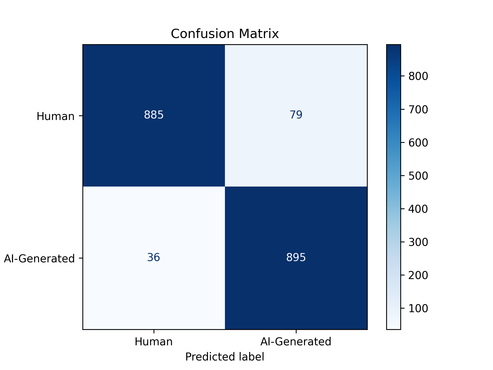
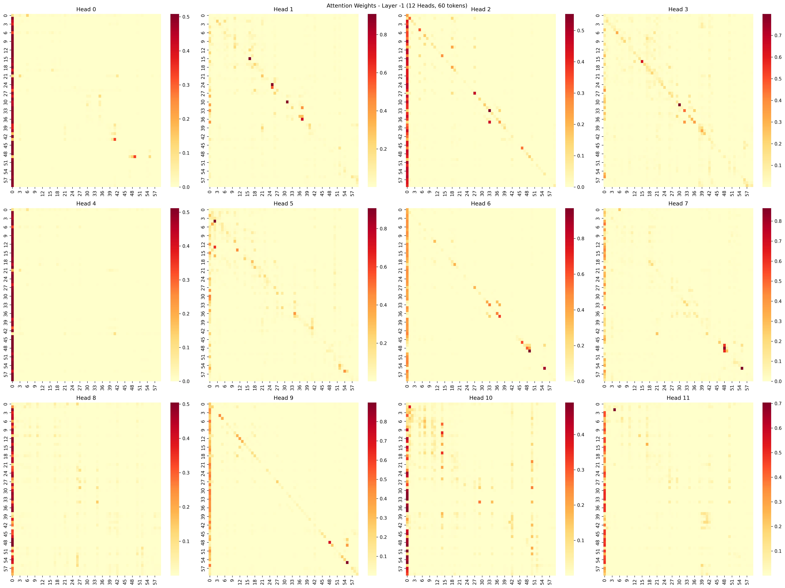

# Aegis: AI vs. Human Python Code Classifier

## Overview
Aegis is a fine-tuned CodeBERT model designed to classify AI-generated and human Python code. While CodeBERT contains 125 million parameters, Aegis was efficiently trained locally using LoRA (Low-Rank Adaptation), updating only a subset of the original parameters.

This project investigates whether AI-generated and human-written code can be told apart from the code itself. Consequently, the dataset (20K raw Python samples: 10K AI + 10K Human; 18,888 after cleaning and deduplication) was aggressively cleaned to ensure standard formatting and the removal of comments and docstrings. A confidence threshold of 0.7 was established to flag samples as AI-generated only when strong evidence exists. Aegis is not a definitive judge; predictions can be imperfect, particularly in tasks where semantic convergence between humans and AI is observed (e.g., LeetCode solutions).

## Installation

```bash
pip install aegis-detect
```

### CLI Usage

**Supported commands**:
```bash
# Predicting using a file
aegis --file path/to/code.py

# Predicting using text
aegis --text "def add(a, b):\n    return a + b"

# JSON output
aegis --file path/to/code.py --json > result.json

# Setting a threshold for AI classification 
aegis --file path/to/code.py --threshold 0.7

# Classify as-is (by default docstrings and comments are stripped first, as in training)
aegis --file path/to/code.py --raw

# Help
aegis --help

# Uninstall
aegis-cleanup 
pip uninstall aegis-detect
```

**Notes**:
- On first run, the model adapter is downloaded from the Hugging Face repo [anthonyq7/aegis](https://huggingface.co/anthonyq7/aegis) and cached under `~/.aegis/models`.
- Internet access is required on the first run; subsequent runs use local cache. 
- The CLI prints the predicted label and probabilities for human and AI.
- If you are upgrading from 1.0.0 or earlier, run `aegis-cleanup` once so the current model is downloaded; otherwise the previously cached model keeps being used.

## Key Results

### Model Performance
Measured at the 0.7 threshold on a held-out test set of 1,895 samples (964 human, 931 AI). Each AI sample written from a specific human sample is kept in the same split as that sample. The exception is the competitive-programming portion, where a human and an AI solution to the same problem can fall in different splits.

- **Accuracy**: 93.93%
- **Precision**: 91.89%
- **Recall**: 96.13%
- **F1-Score**: 93.96%
- **False Positive Rate**: 8.2% of human samples flagged as AI
- **False Negative Rate**: 3.9% of AI samples classified as human

### Confusion Matrix


### Attention Heatmap


## Limitations
The results above are in-distribution. The AI samples come from a single generator (GPT-5.1-codex-mini) under three prompt styles, and the human samples from The Stack and competitive-programming solutions. Much of the signal is stylistic: type hints appear in 73% of the AI training samples and 9% of the human ones. Expect lower accuracy on code from other models or prompts, and on human code written in a modern, type-annotated style.

The November 2026 retrain fixed leakage between the data splits, standardized every sample the same way, and lowered the learning rate. With those fixed, further training changes are unlikely to be meaningful: the remaining limit is the dataset. Improving it would take AI samples from more than one model, prompts that don't dictate coding style, and human samples that better match modern Python.

## Contact
**Email**: a.j.qin@wustl.edu

**Email**: ethanqin@bu.edu

## License
This project is licensed under the [MIT License](LICENSE).
